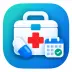

# Mi Botiquín App



[English](README.md) · [Changelog](CHANGELOG.md) · [Licencia](LICENSE) · [Avisos](NOTICE)

[Cómo contribuir](CONTRIBUTING.md) · [Seguridad](SECURITY.md) · [Tareas pendientes](docs/TASKS.md)

Organizador personal de medicación Android/iOS con Kotlin Multiplatform y Compose. Las
cuentas, tratamientos, tomas e inventario se guardan localmente. El acceso valida la contraseña
en este dispositivo y no envía correos ni sincroniza datos. La identificación opcional
de medicamentos españoles consulta CIMA/AEMPS por acción expresa del usuario. La app registra
la pauta del usuario; no diagnostica, prescribe ni recomienda fraccionar comprimidos.

## Implementación actual y validación

| Área | Implementado en código |
|---|---|
| Acceso local | Registro/login con contraseña PBKDF2, sesión protegida en plataforma, Recordarme, cierre y borrado de cuenta |
| Recuperación | Código local de un solo uso generado desde Perfil tras verificar contraseña; restablecimiento con correo, código y nueva contraseña |
| Medicación | Cantidades exactas en cuartos de comprimido y mL, fechas, duración inclusiva, tratamiento indefinido/en pausa, dosis farmacológica y notas opcionales |
| Tomas | Eventos pendientes, detalle, confirmar/omitir, hora de registro, aislamiento e idempotencia |
| Notificaciones | Programación nativa Android/iOS y apertura de la toma concreta, continuando tras autenticación |
| Stock | Recuento inicial explícito, reposiciones, ajustes justificados, umbral de stock bajo, historial y previsión de primera toma no cubierta |
| Escáner España | Google Code Scanner en Android / AVFoundation en iOS, EAN/NTIN españoles compatibles, CN manual, consulta CIMA opcional y confirmación |
| Interfaz | Diseño claro/oscuro basado en capturas y formularios compartidos accesibles |

**Validación actual:** pasan 69 pruebas JVM, 77 comprobaciones iOS ejercitadas y 11 comprobaciones SQLite.
La suite iOS registra un caso adicional de Keychain que retorna sin comprobar el almacén al
no estar disponible en el binario de pruebas; requiere validación en una app firmada.
KSP ha generado Room v11; las migraciones v1--v8→v11 pasan con el validador real de Room en iOS. Las cámaras/CIMA reales, notificaciones y accesibilidad en dispositivo
siguen pendientes. No se ha generado un APK nuevo; el usuario ha limitado la ejecución a pruebas.

## Plataformas, tecnología y estructura

Android requiere SDK mínimo 26; compilación/destino están en [el catálogo de versiones](gradle/libs.versions.toml).
Usa Android Studio y un JDK compatible con las versiones Gradle/AGP del proyecto. iOS necesita
macOS/Xcode y los ajustes de despliegue/firma de `iosApp/iosApp.xcodeproj`.

- `domain`: modelos, validaciones, pautas/previsiones y contratos de repositorios.
- `data`: Room/SQLite, repositorios, almacenamiento protegido y notificaciones/HTTP nativos.
- `presentation`: Compose, ViewModels, navegación, acceso a recursos y cámara nativa.
- `composeApp`: entradas Android/iOS y módulos Koin.
- `commonResources`: traducciones, dimensiones, logo y recursos compartidos.

Se conserva la arquitectura de estado/intenciones/efectos de estilo MVI, Navigation3,
coroutines, kotlinx.datetime, serialization y Koin. El escáner Android añade
`com.google.android.gms:play-services-code-scanner:16.1.0`, sujeto a condiciones propias de Google.

## Compilar y ejecutar

Abre el checkout en Android Studio, deja resolver las dependencias y ejecuta `composeApp`.

```sh
./gradlew :composeApp:assembleDebug
./gradlew :data:testAndroidHostTest :domain:testAndroidHostTest
```

Para iOS abre `iosApp/iosApp.xcodeproj`, elige esquema/dispositivo y configura la firma local.
Pruebas de simulador:

```sh
./gradlew :data:iosSimulatorArm64Test :domain:iosSimulatorArm64Test
```

El esquema actual Room **v11** se ha generado mediante KSP para Android e iOS. Solo deben
incorporarse esquemas producidos por KSP; no se inventan hashes de identidad.

## Requisitos y contribución

El wrapper incluido usa Gradle 9.6.0, Kotlin 2.4.0 y Android Gradle Plugin 9.4.1. Para Android
necesitas JDK 17 o posterior, Android Studio y Android SDK Platform 37; la aplicación requiere
API 26 o posterior para ejecutarse. Para iOS necesitas macOS y Xcode. Un dispositivo con firma
de desarrollo basta para probar avisos o Keychain: el proyecto no se publica en tiendas.

La primera descarga de dependencias requiere internet. El escáner Android puede descargar su
módulo de Google Play services al utilizarse por primera vez. No instales Gradle globalmente ni
subas `local.properties`, secretos, bases de datos o datos sanitarios.

La contribución, las pruebas y las reglas de datos están en [CONTRIBUTING.md](CONTRIBUTING.md).
La aplicación usa acceso local: valida la contraseña en este dispositivo y no envía correos
ni sincroniza datos. Para vulnerabilidades consulta [SECURITY.md](SECURITY.md), sin publicar
datos sensibles en incidencias. La lista priorizada de trabajo está en [docs/TASKS.md](docs/TASKS.md).

## Datos locales, recuperación y privacidad

El acceso es local. Las contraseñas nuevas y los códigos de recuperación usan hashes PBKDF2
con sal. No hay recuperación por correo ni sincronización en la nube. Los repositorios de
medicación, tomas y stock comprueban el identificador de sesión.
El identificador local se conserva entre sesiones para mantener los datos de cada cuenta.
La sesión usa Android Keystore o iOS Keychain; no se afirma que toda la base sanitaria esté cifrada.
Desde Perfil puedes generar un código de recuperación tras verificar la contraseña actual.
Guárdalo fuera del dispositivo: sustituye al código anterior, solo se muestra una vez y se
consume al restablecer el acceso. Sin contraseña ni código generado previamente no se puede
recuperar una cuenta local.

Desde Perfil puedes borrar explícitamente cuenta y datos asociados. Borrar una medicación
elimina también su historial de tomas/stock, con confirmación. No incluyas información sanitaria
real o secretos en logs, incidencias ni capturas. La pantalla de privacidad explica el producto;
no es una política de cumplimiento revisada jurídicamente.

## Reglas de stock

Configura el recuento inicial con lo que tienes físicamente **ahora**. Se registra su fecha de
referencia; no se reconstruyen consumos anteriores. El stock sin configurar es desconocido,
no cero. Las reposiciones y ajustes crean movimientos trazables; los ajustes exigen motivo.
Los identificadores de operación evitan repetir una operación al reintentar.

Con stock configurado, la primera confirmación, el saldo y el movimiento único de consumo se
guardan en una transacción. Reabrir, confirmar dos veces, omitir o descartar un aviso no vuelve
a descontar. Si faltan existencias, la toma queda pendiente con un error: revisa/repón o corrige
el recuento explícitamente. Sin stock configurado se puede registrar la toma sin descuento.
No se permiten saldos negativos ni desbordamientos.

Se utilizan enteros en milésimas; los comprimidos requieren múltiplos de ¼. Con inventario,
la unidad/identidad del producto no puede cambiar silenciosamente. Crea otra medicación para
un producto/presentación diferente. La previsión indica la primera toma futura que el saldo
no cubre, hasta 365 días, sin reposiciones ni omisiones. Excluye tomas atrasadas pendientes y
nunca descuenta por estimación. Sin pauta suficiente o con pausa no inventa fechas.
Consulta [la validación de stock](docs/stock-validation.md).

## Identificación española y consulta opcional

**Escanear** lee identificadores EAN-13/NTIN Data Matrix compatibles o admite un CN manual de
seis dígitos. Los GTIN desconocidos y variantes GS1 no soportadas requieren CN manual: no se
deducen medicamento, pauta, existencias ni divisibilidad. No hay QR/OCR ni resolución GTIN internacional general.

Al pulsar **Consultar CIMA** se envía una petición HTTPS pública con el CN solicitado; el
cliente de catálogo no envía perfil, historial, fotos, lote ni serie. Si falla o no hay internet,
siempre puedes crear la medicación manualmente. Confirma la presentación exacta antes de abrir
el formulario. Solo se precargan nombre y referencia de catálogo; debes elegir cantidad, unidad
y frecuencia. La concentración del envase no se interpreta como dosis prescrita. La procedencia
y fecha se conservan mientras se conserva el nombre verificado; renombrarlo manualmente elimina
esa atribución al guardar.

Android delega la lectura en Google Play services sin permiso CAMERA propio; puede necesitar
la descarga inicial del módulo. El SDK se crea solo al pulsar la lectura. Google puede recibir
métricas técnicas de uso/rendimiento: [condiciones y privacidad](https://developers.google.com/ml-kit/terms).
La entrada manual evita iniciar ese lector. iOS solicita cámara en contexto y usa AVFoundation;
sin cámara o permiso queda disponible el CN manual. Ninguna vía envía imágenes a CIMA.

Fuente: [documentación CIMA REST](https://cima.aemps.es/cima/resources/docs/CIMA_REST_API.pdf) e
[indicaciones de identificadores AEMPS](https://www.aemps.gob.es/informa/la-aemps-actualiza-la-informacion-a-incluir-en-la-aplicacion-de-notificacion-de-comercializacion-de-medicamentos-y-sobre-dispositivos-de-seguridad/).
Se muestran atribución y fecha de consulta; no se implica respaldo ni redistribución de un
catálogo completo. [Implementación y pruebas del escáner](docs/scanner-spain.md).

## Notificaciones y permisos

Android pide POST_NOTIFICATIONS cuando corresponde. Se comprueba acceso a alarmas exactas;
sin él se usa un mecanismo aproximado. Reinicios y cambios de hora/zona recalculan eventos.
Android renueva la ventana al recibir alarmas; iOS planifica como máximo 60 avisos pendientes
y necesita volver a abrir la app para renovarlos. Cierre forzado, permisos y restricciones del
sistema pueden impedir o retrasar avisos. Mostrar una notificación nunca confirma una toma.
El contenido visible es genérico y los datos contienen una referencia al evento.

Pulsarla abre el detalle correspondiente y continúa tras autenticación si hace falta. Otra
cuenta no puede leerlo ni resolverlo. Se distinguen pautas pausadas/cambiadas, eventos borrados
y tomas ya resueltas. [Matriz de aceptación nativa](docs/reminder-validation.md).

## Referencias de diseño y verificaciones

Estas imágenes facilitadas son **referencias de diseño**, no capturas de una nueva build validada:
[Login](screenshots/login.png), [Registro](screenshots/register.png),
[Recuperación](screenshots/forgot_password.png), [Ajustes](screenshots/settings.png).

[Sistema de diseño](docs/design-system.md) · Previews de Android Studio:
`presentation/src/commonMain/kotlin/com/connectapp/presentation/preview/DesignPreviews.kt`.

```sh
python3 scripts/run_domain_checks.py
python3 scripts/verify_recovery_sql.py
```

Las comprobaciones con compilador en caché/SQLite no sustituyen Gradle, KSP, Compose ni pruebas
en dispositivo. Gradle requiere acceso autorizado a su caché global fuera del entorno restringido. Las nuevas dependencias Google pueden
necesitar red. Las bases v1--v4 se migran sin borrar datos; no desinstales como solución.
Se incluyen migraciones v1→v11 comprobadas con SQLite y el esquema v11 exportado por KSP.

## Pendientes y contribución

Pendientes: aceptación/build nativa e inventario de licencias; horarios arbitrarios por días;
historial completo/exportación, archivado, diagnóstico de notificaciones,
OCR/GTIN general y política de privacidad revisada para publicación. No se presupone nube.
Mantén cambios incrementales, conserva datos, añade pruebas de dominio/persistencia relevantes
y actualiza ambos README y [CHANGELOG.md](CHANGELOG.md).

El código usa [Apache License 2.0](LICENSE). Conserva [NOTICE](NOTICE) y [NOTICE.md](NOTICE.md)
heredado. SDK Google, frameworks de plataforma e información AEMPS tienen condiciones propias.
La autoría/atribución del logo y el inventario completo de avisos transitivos requieren confirmación
antes de publicar; véanse los TODO explícitos de NOTICE.
